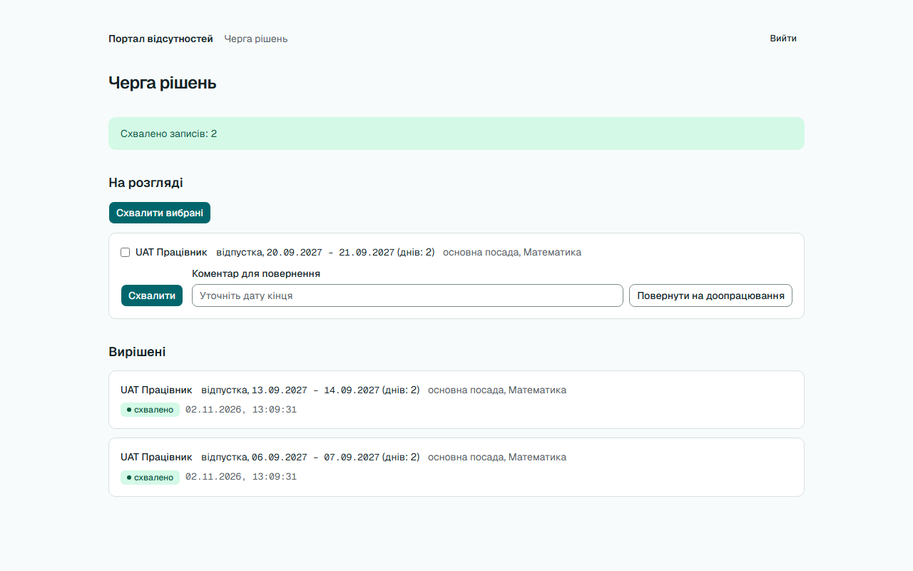
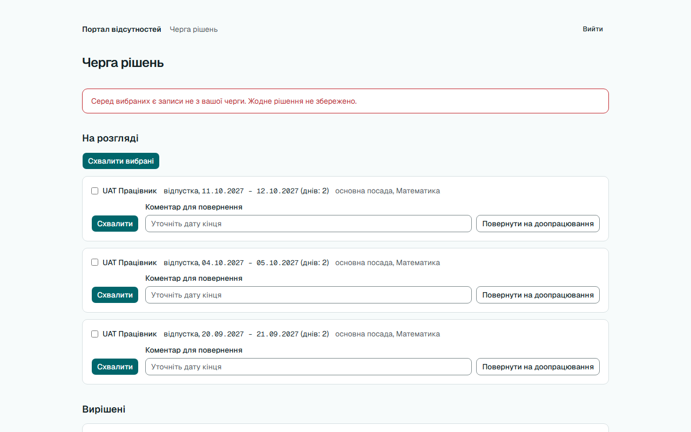
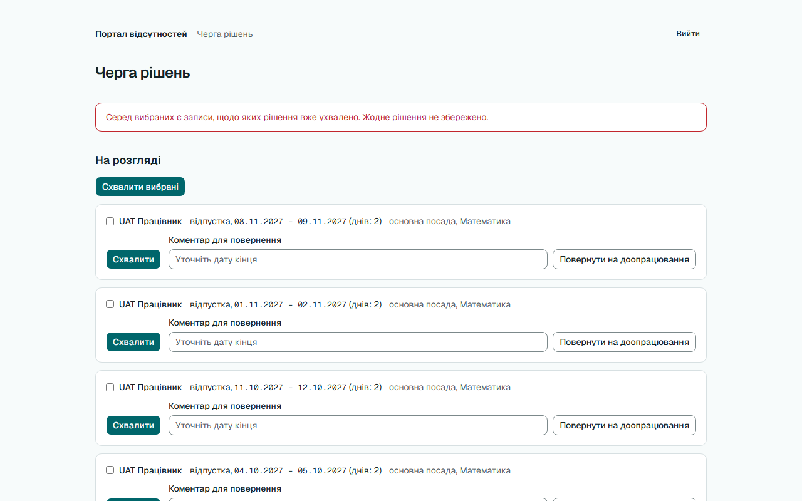
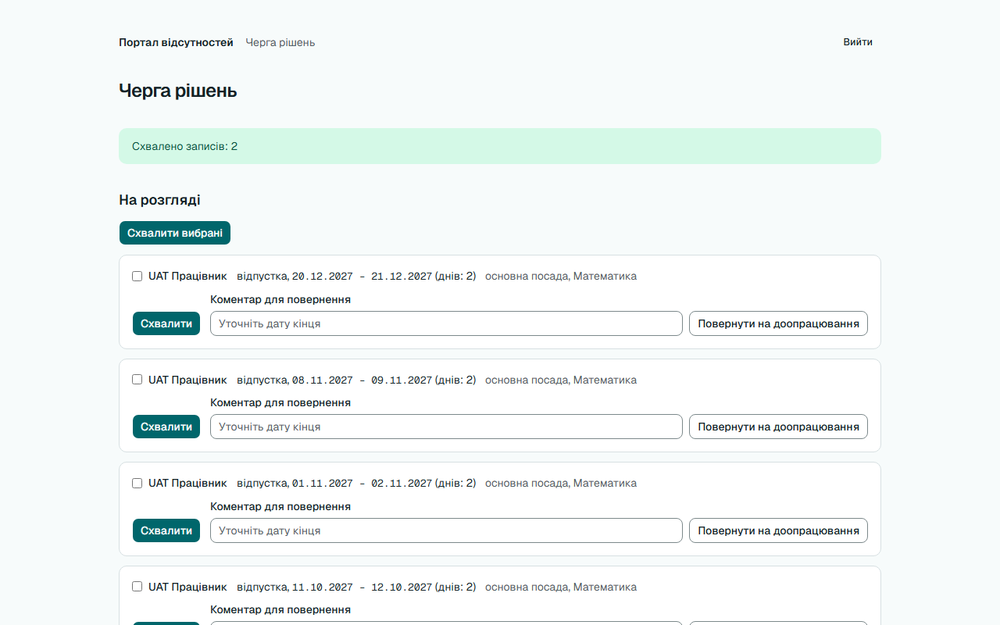

# Звіт UAT — 02.11.2026

- **Застосунок:** https://quitcode-ws9-leave-portal-factory.vercel.app (/api/health: коміт `55c748e`)
- **Код тестів:** `main` @ `55c748e`
- **Прогін:** 02.11.2026, 13:09 (Київ), Playwright 66.5 с; AC: 4 — PASS 3, FAIL 0, NEEDS-HUMAN 1
- **Рецензент:** `claude-haiku-5-5`; суперечки → `claude-sonnet-5-5`. Разом за розбір: $0.0466 (ціни API; за підпискою — у межах ліміту плану)
- **Прибирання:** синтетичних uat-*@example.test видалено 5, лишилось 0, заявок, що лишились: 0
- **Відео й траси:** не в git — `test-results/` локально або артефакт CI; трасу відкриває `npx playwright show-trace <trace.zip>`

| AC | Перевірки | Агент | Підсумок | Чому | Playwright | Розбір |
|---|---|---|---|---|---|---|
| AC-BULK-01 | пройшли | Haiku: PASS | **PASS** | R6: перевірки, агент і цитати збігаються | 11.6 с | $0.0027, 11.9 с |
| AC-BULK-02 | пройшли | Haiku: PASS | **PASS** | R6: перевірки, агент і цитати збігаються | 10.4 с | $0.0029, 16.0 с |
| AC-BULK-03 | пройшли | Haiku: PASS | **PASS** | R6: перевірки, агент і цитати збігаються | 16.0 с | $0.0023, 9.5 с |
| AC-BULK-04 | пройшли | Haiku: NEEDS-HUMAN, Sonnet: NEEDS-HUMAN | **NEEDS-HUMAN** | R3: перевірки пройшли, агент не погоджується — вирішує людина | 10.7 с | $0.0387, 24.4 с |

## AC-BULK-01 — PASS

**Тест:** AC-BULK-01: менеджер «Математики» позначає 2 з 3 записів і схвалює вибрані — обидва схвалено з автором і часом, третій на розгляді

**Критерій** (requirements/02-bulk-decisions.md):

> AC-BULK-01: Дано у черзі менеджера «Математики» 3 записи на розгляді. Коли менеджер позначає 2 з них і схвалює вибрані однією дією. Тоді обидва позначені записи мають статус «схвалено», у кожного автор рішення — цей менеджер і час рішення, а третій запис лишається на розгляді.

**Кроки:** ✔ Дано: у черзі менеджера «Математики» 3 записи на розгляді → ✔ Коли: менеджер позначає 2 з них і схвалює вибрані однією дією → ✔ Тоді: обидва позначені записи мають статус «схвалено», у кожного автор рішення — цей менеджер і час рішення, а третій запис лишається на розгляді

**Агент (claude-haiku-5-5, PASS):** На кадрі frame-then-1.png (/manage) у розділі «Вирішені» видно два записи з «схвалено» і часом 02.11.2026, 13:09:31 — 06.09.2027–07.09.2027 і 13.09.2027–14.09.2027. Запис 20.09.2027–21.09.2027 стоїть у розділі «На розгляді». Авторство рішення (decided_by) з кадру не видно, тому це не оцінювалося.

**Цитати агента, звірені зі сторінкою (aria):**
- «Вирішені» — є на сторінці
- «UAT Працівник відпустка, 13.09.2027 – 14.09.2027 (днів: 2) основна посада, Математика» — є на сторінці
- «схвалено» — є на сторінці
- «02.11.2026, 13:09:31» — є на сторінці
- «UAT Працівник відпустка, 06.09.2027 – 07.09.2027 (днів: 2) основна посада, Математика» — є на сторінці
- «схвалено» — є на сторінці
- «02.11.2026, 13:09:31» — є на сторінці
- «На розгляді» — є на сторінці
- «UAT Працівник відпустка, 20.09.2027 – 21.09.2027 (днів: 2) основна посада, Математика» — є на сторінці

**Правило:** R6: перевірки, агент і цитати збігаються

**Відео:** `test-results/artifacts/manage-bulk-AC-BULK-01-мен-07912--і-часом-третій-на-розгляді-chromium/video.webm` · **траса:** `test-results/artifacts/manage-bulk-AC-BULK-01-мен-07912--і-часом-третій-на-розгляді-chromium/trace.zip` (не в git)

**Рішення PM:** ☐ приймаю · ☐ відхилення від вимог (issue «Відхилення від вимог: AC-BULK-01 — …») · @login: ____

## AC-BULK-02 — PASS

**Тест:** AC-BULK-02: серед вибраних запис «Початкової школи» (підмінений запит) — жоден запис не змінено, повідомлення про записи не з черги

**Критерій** (requirements/02-bulk-decisions.md):

> AC-BULK-02: Дано менеджер «Математики» позначив 2 записи на розгляді зі своєї черги і 1 запис на розгляді підрозділу «Початкова школа». Коли він схвалює вибрані. Тоді жоден із 3 записів не змінюється — усі лишаються на розгляді без автора рішення, — а менеджер бачить повідомлення «Серед вибраних є записи не з вашої черги. Жодне рішення не збережено.»

**Кроки:** ✔ Дано: менеджер «Математики» позначив 2 записи на розгляді зі своєї черги і 1 запис на розгляді підрозділу «Початкова школа» → ✔ Коли: він схвалює вибрані → ✔ Тоді: жоден із 3 записів не змінюється — усі лишаються на розгляді без автора рішення, — а менеджер бачить повідомлення «Серед вибраних є записи не з вашої черги. Жодне рішення не збережено.»

**Агент (claude-haiku-5-5, PASS):** На кадрі frame-then-1.png (/manage, «Черга рішень») видно червоне повідомлення з точним текстом критерію, і в розділі «На розгляді» стоять обидва записи 11.10.2027 – 12.10.2027 та 04.10.2027 – 05.10.2027 без жодних ознак рішення. Запис «Початкової школи» на кадрі не видно: у «На розгляді» показано лише три записи «Математики» (третій — 20.09.2027 – 21.09.2027), а розділ «Вирішені» обрізаний унизу. Це не входить до видимих частин «Тоді», тому вердикт PASS, але стан цього запису з кадру не підтверджується.

**Цитати агента, звірені зі сторінкою (aria):**
- «Серед вибраних є записи не з вашої черги. Жодне рішення не збережено.» — є на сторінці
- «На розгляді» — є на сторінці
- «UAT Працівник відпустка, 11.10.2027 – 12.10.2027 (днів: 2) основна посада, Математика» — є на сторінці
- «UAT Працівник відпустка, 04.10.2027 – 05.10.2027 (днів: 2) основна посада, Математика» — є на сторінці

**Правило:** R6: перевірки, агент і цитати збігаються

**Відео:** `test-results/artifacts/manage-bulk-AC-BULK-02-сер-a9cd9-лення-про-записи-не-з-черги-chromium/video.webm` · **траса:** `test-results/artifacts/manage-bulk-AC-BULK-02-сер-a9cd9-лення-про-записи-не-з-черги-chromium/trace.zip` (не в git)

**Рішення PM:** ☐ приймаю · ☐ відхилення від вимог (issue «Відхилення від вимог: AC-BULK-02 — …») · @login: ____

## AC-BULK-03 — PASS

**Тест:** AC-BULK-03: серед вибраних запис, який тим часом схвалено, — жоден запис не змінено, повідомлення про ухвалене рішення

**Критерій** (requirements/02-bulk-decisions.md):

> AC-BULK-03: Дано менеджер «Математики» позначив 2 записи на розгляді і 1 запис своєї черги, який уже схвалено. Коли він схвалює вибрані. Тоді жоден запис не змінюється: 2 записи лишаються на розгляді, у схваленого той самий автор і час рішення, а менеджер бачить повідомлення «Серед вибраних є записи, щодо яких рішення вже ухвалено. Жодне рішення не збережено.»

**Кроки:** ✔ Дано: менеджер «Математики» позначив 2 записи на розгляді і 1 запис своєї черги, який уже схвалено → ✔ Коли: він схвалює вибрані → ✔ Тоді: жоден запис не змінюється: 2 записи лишаються на розгляді, у схваленого той самий автор і час рішення, а менеджер бачить повідомлення «Серед вибраних є записи, щодо яких рішення вже ухвалено. Жодне рішення не збережено.»

**Агент (claude-haiku-5-5, PASS):** На кадрі /manage (сторінка «Черга рішень») червоним написано саме те повідомлення, що вимагає критерій, посимвольно збіжне з ним. Під заголовком «На розгляді» видно обидва записи з критерію: 01.11.2027 – 02.11.2027 і 08.11.2027 – 09.11.2027. Частину про базу (автор, decided_by/decided_at) з кадрів не оцінено.

**Цитати агента, звірені зі сторінкою (aria):**
- «Серед вибраних є записи, щодо яких рішення вже ухвалено. Жодне рішення не збережено.» — є на сторінці
- «На розгляді» — є на сторінці
- «відпустка, 01.11.2027 – 02.11.2027 (днів: 2)» — є на сторінці
- «відпустка, 08.11.2027 – 09.11.2027 (днів: 2)» — є на сторінці

**Правило:** R6: перевірки, агент і цитати збігаються

**Відео:** `test-results/artifacts/manage-bulk-AC-BULK-03-сер-da658-млення-про-ухвалене-рішення-chromium/video-1.webm` · **траса:** `test-results/artifacts/manage-bulk-AC-BULK-03-сер-da658-млення-про-ухвалене-рішення-chromium/trace.zip` (не в git)

**Рішення PM:** ☐ приймаю · ☐ відхилення від вимог (issue «Відхилення від вимог: AC-BULK-03 — …») · @login: ____

## AC-BULK-04 — NEEDS-HUMAN

**Тест:** AC-BULK-04: черга після «Схвалити вибрані» — 2 записи у «Вирішені» зі статусом «схвалено», третій «На розгляді», «Схвалено записів: 2»

**Критерій** (requirements/02-bulk-decisions.md):

> AC-BULK-04: Дано менеджер «Математики» відкрив чергу рішень, де 3 записи на розгляді. Коли він позначає 2 з них і натискає «Схвалити вибрані». Тоді ці 2 записи показано в розділі «Вирішені» зі статусом «схвалено», третій лишається в розділі «На розгляді», а менеджер бачить повідомлення «Схвалено записів: 2».

**Кроки:** ✔ Дано: менеджер «Математики» відкрив чергу рішень, де 3 записи на розгляді → ✔ Коли: він позначає 2 з них і натискає «Схвалити вибрані» → ✔ Тоді: ці 2 записи показано в розділі «Вирішені» зі статусом «схвалено», третій лишається в розділі «На розгляді», а менеджер бачить повідомлення «Схвалено записів: 2»

**Агент (claude-sonnet-5-5, NEEDS-HUMAN):** На кадрі є зелене повідомлення про схвалення і запис 20.12.2027 – 21.12.2027 у розділі «На розгляді». Розділ «Вирішені» не видно, а в «На розгляді» є ще кілька записів, тож результат за кадром підтвердити не можна.

Haiku сказав NEEDS-HUMAN, тож розбір повторив Sonnet; рішення агента — за Sonnet.

**Агент бачить вади:**
- На кадрі не видно розділу «Вирішені» — він нижче межі екрана, тому записи 06.12.2027 – 07.12.2027 і 13.12.2027 – 14.12.2027 з підписом «схвалено» підтвердити неможливо.
- У розділі «На розгляді» видно також записи 08.11.2027 – 09.11.2027, 01.11.2027 – 02.11.2027, 11.10.2027 – 12.10.2027, хоча за умовою на розгляді мав лишитися один запис.

**Цитати агента, звірені зі сторінкою (aria):**
- «Схвалено записів: 2» — є на сторінці
- «На розгляді» — є на сторінці
- «відпустка, 20.12.2027 - 21.12.2027 (днів: 2)» — НЕМАЄ на сторінці

**Правило:** R3: перевірки пройшли, агент не погоджується — вирішує людина

**Відео:** `test-results/artifacts/manage-bulk-AC-BULK-04-чер-3d72b-гляді»-«Схвалено-записів-2»-chromium/video.webm` · **траса:** `test-results/artifacts/manage-bulk-AC-BULK-04-чер-3d72b-гляді»-«Схвалено-записів-2»-chromium/trace.zip` (не в git)

**Рішення PM:** ☐ приймаю · ☐ відхилення від вимог (issue «Відхилення від вимог: AC-BULK-04 — …») · @login: ____

## Як читати підсумок

- **PASS** — автоматичні перевірки пройшли, агент-рецензент погодився з кадром, а кожну його цитату знайдено на сторінці.
- **FAIL** — впала автоматична перевірка. Агент цього не перекриває: невидимі вади (буфер обміну, база) він на кадрі не побачить.
- **NEEDS-HUMAN** — перевірки зелені, але агент не погодився або його цитати немає на сторінці. Часто це слабкий тест або розбіжність між текстом AC і тестом — питання до PM, а не обов'язково вада продукту.

Правила: R1: перевірка впала — FAIL завжди, агент не перекриває; R2: немає вердикту агента або кадру; R3: перевірки пройшли, агент не погоджується — вирішує людина; R4: цитати агента немає на сторінці (aria) — не підтверджено; R5: помилка сторінки або 5xx під час сценарію; R6: перевірки, агент і цитати збігаються.
